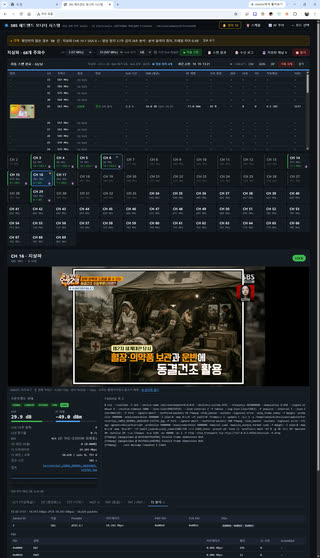
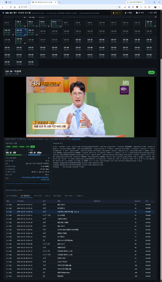
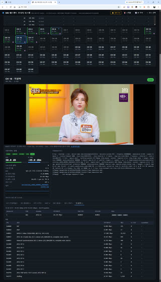
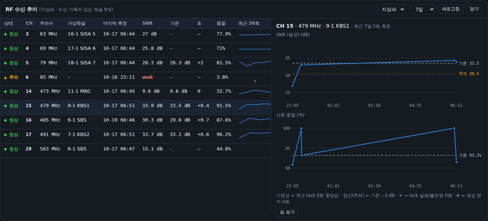
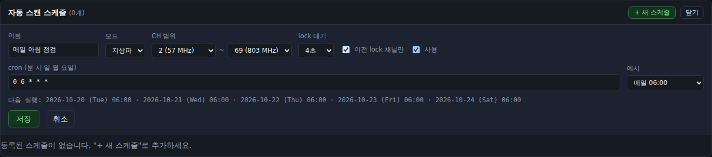

# SBS 헤드엔드 모니터 시스템 (atscscan)

SBS 목동 사내공청시스템은 ATSC 모듈레이터로 70개가 넘는 채널을 운용하고 있으며, 유지보수는 방송기기 정비실이 담당합니다.
이 시스템은 그 헤드엔드 모듈레이터들의 출력과 동작 상태를 매일 모니터링합니다.
리눅스 DVB ATSC 수신기(Skydigital SKYTV HD USB mini, Hauppauge WinTV-HVR-975, DViCO FusionHDTV7 USB 등)로 각 채널을 튜닝해
수신 레벨(SNR, RF 레벨, 신호 품질, BER/UCB)과 PSIP를 확인합니다.
정해진 시각에 자동 스캔하고, 채널별 이력과 비교해 수신 값이 크게 떨어지거나 영상이 멈추면 화면과 텔레그램으로 알립니다.

### 화면

그림을 누르면 원본 크기로 볼 수 있습니다.

<table>
  <tr>
    <td align="center" valign="top"><a href="docs/images/ui1.png"></a><br><sub>자동 스캔 결과 · 채널 버튼 · WebRTC 미리보기 · 프론트엔드 상태</sub></td>
    <td align="center" valign="top"><a href="docs/images/ui2.png"></a><br><sub>PSIP EIT(편성표) 탭</sub></td>
    <td align="center" valign="top"><a href="docs/images/ui3.png"></a><br><sub>TS 분석 탭 (서비스 · PID별 비트레이트)</sub></td>
  </tr>
</table>



- 수신기: 커널이 지원하는 ATSC 수신기면 됩니다. SKYTV HD USB mini용 드라이버는 [sendust/skytv_hdusbmini](https://github.com/sendust/skytv_hdusbmini)
- 만들면서 쓴 기술 정리: [skills/](skills/README.md)

## 설치

필요한 것: Ubuntu, Python 3(표준 라이브러리만 사용), 동작하는 DVB 수신기(`/dev/dvb/adapter0`), TSDuck(`tsp`), ffmpeg,
WebRTC 미리보기를 쓰려면 [mediamtx](https://github.com/bluenviron/mediamtx)(기본 설정, RTSP 8554 / WebRTC 8889·UDP 8189).

```sh
git clone git@github.com:sendust/atscscan.git ~/atscscan && cd ~/atscscan
cp config.example.json config.json && chmod 600 config.json     # 텔레그램 토큰·수신자, "nvidia" 등 편집
sudo usermod -aG video $USER                                     # /dev/dvb 접근 (다시 로그인)
./run.sh                                                         # http://<서버>:8088/

# 상시 실행 (스케줄 스캔을 쓰려면 권장): 사용자·경로를 환경에 맞게 고친 뒤
sudo cp deploy/atscscan.service /etc/systemd/system/ && sudo systemctl daemon-reload
sudo systemctl enable --now atscscan
```
- `channel.json`은 지상파(68개)·케이블(135개) 중심 주파수표입니다. 사내 헤드엔드는 케이블 채널도 ATSC 8-VSB로 송출합니다.
- `config.json`, `data/`, `logs/`, `capture/`는 저장소에 올리지 않습니다(`.gitignore`). 처음 실행하면 만들어집니다.

## 실행

**서비스로 실행 중입니다** (`/etc/systemd/system/atscscan.service`, 계정 sendust, 비정상 종료 시 자동 재시작, 부팅 시 자동 시작).
```sh
sudo systemctl status atscscan       # 상태
sudo systemctl restart atscscan      # 코드·설정 반영 (config.json은 재시작 없이 자동 반영)
journalctl -u atscscan -f            # 로그
sudo systemctl disable --now atscscan   # 서비스 해제
```
수동 실행(서비스를 멈춘 뒤):

```sh
~/atscscan/run.sh                 # 기본: 0.0.0.0:8088, adapter 0
~/atscscan/run.sh --port 9000 --adapter 0
```

브라우저에서 `http://<서버 IP>:8088/` 로 접속합니다. 계정이 `video` 그룹에 있으면 sudo가 필요 없습니다.
인증 기능이 없으므로 신뢰할 수 있는 네트워크에서만 여세요(내부망만 쓰려면 `--host 127.0.0.1`로 띄우고 SSH 터널 사용).

## 구성

```
config.json         텔레그램·경보 설정 (권한 600)
data/               saved_channels.json, scans/ (스캔 기록), schedules.json (스케줄), alerts.json (경보)
capture/            lock 시 저장한 프레임 (JPEG)
logs/               reception.log/.jsonl (전체 수신 로그), channels/ (채널별 RF 로그)
channel.json        ~/atsc/channel.json 복사본 (terrestrial 68개, catv 135개, 중심 주파수 MHz)
backend/server.py   Python 표준 라이브러리만 사용 (HTTP + tsp 프로세스 관리 + frontend ioctl)
backend/monitor.py  설정, cron 스케줄러, 채널별 이력·기준값, 경보, 텔레그램
config.example.json 설정 예시 (복사해서 config.json으로)
deploy/             atscscan.service (systemd 유닛 예시)
skills/             만들면서 쓴 기술 정리 (SKILL.md 7개)
docs/images/        README 그림
www/                index.html, app.js(수신·스캔), monitor.js(경보·스케줄·추이), style.css (프레임워크 없음)
```

## 동작 방식

- 주파수 버튼을 누르면 백엔드가 TSDuck을 실행합니다.
  `tsp -I dvb … -P tables --log-json-line -P analyze --json-line -O drop`
  (tables는 PID 필터 없이 전체 PID를 봅니다. EIT/ETT PID는 MGT가 정하며 방송사마다 다릅니다: KBS 0x1D00~, SBS 0x1A00~)
  - 지상파, 케이블 모두 `--delivery-system ATSC --modulation 8-VSB`
    (사내 공청 헤드엔드가 케이블 135개 채널도 ATSC 8-VSB로 송출하므로 케이블 모드도 8-VSB로 복조.
    QAM이 필요해지면 `backend/server.py`의 `MODES['catv']`를 `DVB-C/B` / `256-QAM`으로 바꾸면 됨)
- tsp가 실행되는 동안 `/dev/dvb/adapter0/frontend0`을 읽기 전용으로 열고 DVBv3 ioctl로 1초마다
  lock 비트, SNR, 신호 품질, UCB를 읽습니다.
  (TSDuck dvbstatus에는 lgdt3305 드라이버의 SNR/세기 값이 나오지 않기 때문)
- lock이 잡히면 PSIP/PSI 테이블을 실시간으로 수집해 탭별 표로 보여줍니다.
  - VCT(가상채널), EIT(편성표, ETT 상세 설명 연결, KST 표시), STT(방송 시각), MGT, RRT, PAT/PMT
  - TS 분석: 서비스/PID별 비트레이트, 패킷 수, CC 오류
    - 비디오 프레임 레이트는 캡처용 ffmpeg가 디코딩한 값으로 표시합니다. TSDuck 3.44 이하의 `analyze`/`pes`는
      MPEG-2 비디오를 frame_rate_code와 관계없이 항상 "@25 Hz"로 표시합니다(23.976/25/29.97/30/59.94 시험 스트림으로 확인).
      **TSDuck 3.45-4798에서 고쳐졌습니다**(같은 시험 스트림이 23.97/25/29.97/30/59.94 Hz로 나옴). 3.45 이상을 권장하고,
      이전 버전에서도 맞게 보이도록 보정은 그대로 둡니다.
- 다른 버튼을 누르거나 "중지"를 누를 때까지 계속 수신합니다.

## 헤드엔드 모니터링

### 채널별 RF 로그
측정이 끝날 때마다(자동·스케줄·수동 모두) `logs/channels/<모드>_ch<번호>.jsonl`에 한 줄씩 추가합니다.
각 줄에는 시각, 구분(schedule/scan/manual), 결과, lock 시간, SNR 평균·최소·마지막, 신호 품질, UCB, 비트레이트, TSID,
가상채널, 캡처 파일, 스캔 ID, **그 시점의 기준값**(아래)이 들어 있습니다. 처음 실행할 때 기존 `logs/reception.jsonl`을 채널별 파일로 옮겼습니다.

### 스케줄 (⏰ 스케줄)
crontab과 같은 5필드 형식(`분 시 일 월 요일`)으로 자동 스캔을 예약합니다. `*`, 목록(`6,18`), 범위(`1-5`), 간격(`*/30`),
요일·월 이름(`mon`, `jan`), `@daily`/`@hourly`를 지원합니다. 일과 요일을 둘 다 지정하면 cron처럼 둘 중 하나만 맞아도 실행합니다.

| 예시 | 의미 |
|---|---|
| `0 6 * * *` | 매일 06:00 |
| `0 6,18 * * *` | 매일 06:00, 18:00 |
| `0 6 * * 1-5` | 평일 06:00 |
| `0 */3 * * *` | 3시간마다 |

- 스케줄마다 이름, 모드(지상파/케이블), 채널 범위, lock 대기 시간(2~10초), 이전 lock 채널만, 사용 여부를 정합니다. 입력하면 다음 실행 5회를 미리 보여줍니다.


- "지금 실행"으로 바로 돌릴 수 있습니다. 같은 시각에 여러 스케줄이 잡히면 차례로 실행하고, 이미 스캔 중이면 끝난 뒤 시작합니다.
- 스케줄 스캔이 시작되면 진행 중인 수동 튜닝은 중지됩니다. 반대로 스캔 중에 사용자가 주파수 버튼을 누르면 그 스캔은 중단됩니다.
- 시각은 서버 시간(KST) 기준이며, 저장 위치는 `data/schedules.json`입니다.

### 이상 판정과 알림 (🔔 경보)
채널마다 **최근 lock 측정 7회의 SNR·신호 품질 중앙값**을 기준값으로 삼고, 자동/스케줄 스캔의 각 측정을 비교합니다.

| 조건 | 심각도 |
|---|---|
| 평소 lock되던 채널(기준값 3회 이상)이 lock 실패 | 위험 |
| lock 비트는 켜졌지만 TS가 없음(불안정) | 위험 |
| SNR이 기준보다 3 dB 이상 낮음 (6 dB 이상이면 위험) | 주의 |
| 신호 품질이 기준보다 15%p 이상 낮음 | 주의 |

- 같은 채널에 해제되지 않은 같은 종류의 경보가 있으면 다시 만들지 않습니다(매 스캔마다 반복 알림 없음).
- 다음 측정에서 정상으로 돌아오면 자동으로 **해제**되고, 설정에 따라 복구 알림을 보냅니다.
- 화면: 헤더의 🔔 배지(미확인 수, 위험이면 빨강), 상단 배너, 경보 목록(확인 처리, 해당 채널 추이 바로 보기).
- 텔레그램: 스캔 한 번에 **메시지 한 통**으로 신규 경보·복구·요약을 묶어 보냅니다.
- 경보 기록은 `data/alerts.json`(최근 1000건)에 저장됩니다.
- 수동 튜닝도 판정하려면 `alerts.alert_on_manual`을 `true`로 바꿉니다.

### config.json
처음 실행할 때 기본값으로 만들어집니다(권한 600, 웹으로는 제공하지 않음). **저장하면 재시작 없이 바로 반영**됩니다.
```json
{
  "title": "SBS 헤드엔드 모니터 시스템",
  "nvidia": true,                            // true: GPU(NVENC+CUDA) 미리보기, false: CPU만 사용
  "device_label": "",                        // 헤더에 보일 수신기 이름. 비우면 카드에서 읽음(USB 제품명 · 프론트엔드)
  "adapter": "auto",                         // 쓸 /dev/dvb/adapterN, 또는 "auto"
  "frontend": "auto",                        // 프론트엔드 번호, 또는 "auto"(모드의 방송 방식을 지원하는 첫 프론트엔드)
  "modes": {},                               // 모드별 방송 방식 변경, 예: {"catv": {"delivery": "DVB-C/B", "modulations": ["256-QAM"]}}
  "freeze": {
    "enabled": true,                         // 자동/스케줄 스캔에서 첫 번째 서비스 영상 정지 분석
    "min_sec": 2.0,                          // 이 시간 이상 화면이 멈추면 '영상 정지' (분석 시간의 90%를 넘지 않음)
    "diff_threshold": 1.0,                   // 프레임 간 평균 휘도 차이(0~255) 이 값 미만 = 정지 프레임
    "smooth_frames": 9,                      // 이동 중앙값 프레임 수 (인코더 GOP 잡음 제거)
    "alert": true                            // 영상 정지를 경보(주의)·텔레그램으로도 알림
  },
  "telegram": {
    "enabled": true,
    "bot_token": "123456789:AA...",          // @BotFather에서 받은 봇 토큰
    "chat_ids": ["123456789", "-1001234567890"],  // 받을 사용자 id 또는 그룹 id (여러 명 가능)
    "notify_recovery": true,                 // 복구 알림
    "send_scan_summary": false               // 경보가 없어도 스케줄 스캔마다 요약 전송
  },
  "alerts": {
    "baseline_count": 7, "min_baseline": 3,
    "snr_drop_db": 3.0, "snr_critical_drop_db": 6.0,
    "strength_drop_pct": 15.0, "alert_on_manual": false
  }
}
```
(실제 파일은 JSON이라 `//` 주석을 쓸 수 없습니다.)
- 사용자 id 확인: 봇에게 아무 메시지를 보낸 뒤 `https://api.telegram.org/bot<토큰>/getUpdates`의 `message.chat.id`.
  그룹에 보내려면 봇을 그룹에 초대하고 그룹 id(음수)를 넣습니다.
- 경보 패널의 **텔레그램 테스트** 버튼으로 전송을 확인할 수 있고, 마지막 전송 결과(성공/실패 사유)가 표시됩니다.

### GPU 유무 (`"nvidia"`)
- `true`: 실제로 NVENC가 동작하는지 확인한 뒤 CUDA 디코딩 + `yadif_cuda`/`scale_cuda` + `h264_nvenc`로 720p 미리보기.
  NVENC를 쓸 수 없으면 로그에 남기고 자동으로 CPU로 바꿉니다.
- `false`: CUDA·NVENC를 전혀 쓰지 않습니다. 소프트웨어 디코딩 + `bwdif` + 960×540 + `libx264 ultrafast`
  (libx264가 없으면 libopenh264, 그것도 없으면 VP8 `libvpx`). i7-6700K 기준 약 190% CPU(코어 2개 정도).
- 값을 바꾸면 다음 튜닝부터 적용됩니다(재시작 불필요). 화면 미리보기 아래에 현재 인코더가 표시됩니다.

### 영상 정지(freeze) 감지
- 자동·스케줄 스캔에서 lock된 채널마다 첫 번째 서비스 영상을 **lock 대기 시간과 같은 시간**(2~10초) 동안 분석합니다.
  lock된 채널당 체류 시간은 대략 lock 대기 시간 + 2초입니다.
- 방법: 프레임마다 앞 프레임과의 평균 휘도 차이(ffmpeg `tblend` + `signalstats`, 0~255)를 구하고, 9프레임 이동 중앙값으로
  인코더 키프레임 잡음을 걸러낸 뒤, `diff_threshold`(1.0) 미만이 `min_sec`(2초) 이상 이어지면 **영상 정지**입니다.
  분석 시간이 2초처럼 짧으면 기준 시간은 분석 시간의 90%로 줄어듭니다.
  - 실측: 정지 화면이던 케이블 CH85(591 MHz)는 0.25~0.29, 정상 방송(KBS1)은 최소 3.2 / 중앙값 8.2.
    처음 쓰던 ffmpeg `freezedetect`(−60 dB)는 헤드엔드 인코더가 키프레임마다 내는 0.4~1.2 잡음 때문에 CH85를 놓쳤습니다.
- 분석 끝까지 멈춰 있으면 "+"를 붙입니다(예: `❄ 정지 4.2초+`). 결과에는 프레임 차이 중앙값도 남습니다.
- 화면 표시: 스캔 결과 행 강조(파란 배경·왼쪽 띠), 썸네일 "❄ 정지" 배지, 영상 열, 스캔 요약 "❄ 영상 정지 N개",
  주파수 버튼 ❄ 표시, 수신 로그·RF 추이 표, 추이 그래프의 ❄ 표식.
- `alert: true`이면 '영상 정지' 경보(주의)가 생기고 텔레그램 메시지에도 포함됩니다. 다음 스캔에서 영상이 정상이면 자동 해제됩니다.
- 컬러바·정지 슬레이트처럼 원래 움직이지 않는 화면도 정지로 판정됩니다.

### 여러 종류의 수신기 지원
카드마다 프론트엔드 구성, 통계 제공 방식, 단위, 주파수 범위가 다릅니다. 백엔드(`backend/dvbdev.py`)가 다음을 자동으로 처리합니다.

| 항목 | 처리 |
|---|---|
| 장치 선택 | `/dev/dvb/adapter*/frontend*`를 모두 찾고 지원 방송 방식(`DTV_ENUM_DELSYS`)을 읽어, 모드의 방식(ATSC 등)을 지원하는 프론트엔드를 고름. ATSC가 frontend1인 카드도 동작(tsp `--device-name /dev/dvb/adapterA:F:0:0`). `adapter`/`frontend`로 직접 지정 가능 |
| SNR | DVBv5 CNR(dB)을 우선. 없으면 DVBv3 SNR을, 단위를 아는 드라이버(LGDT3304/3305/3306A, AU8522)만 dB로 환산하고 나머지는 "raw"로 표시 |
| RF 레벨 | 카드가 DVBv5로 dBm을 주면 **RF 레벨(dBm)**로 표시·기록·그래프·경보(기준 대비 6 dB 하락 주의, 10 dB 위험). 상대값만 주면 신호 품질 % |
| BER | DVBv5 오류 비트/전체 비트 카운터의 증가량으로 계산(post-FEC 우선, 없으면 pre). DVBv3 BER은 단위가 드라이버마다 정의되지 않고 0이나 0xFFFFFFFF만 주는 경우가 많아 쓰지 않음 |
| 주파수 범위 | 카드의 최소·최대 주파수 밖 채널(예: 858 MHz 카드의 861 MHz)은 스캔에서 제외하고 "범위 밖 N개 제외"로 표시 |
| 기준값 | 측정마다 어떤 카드로 쟀는지(`device`: USB ID + 프론트엔드 이름) 기록하고, **같은 카드의 측정끼리만** 기준값을 계산. 그래프는 카드가 바뀐 지점에서 선을 끊고 "수신기 변경"을 표시 |
| 이름 | 헤더에 USB 제품명 · 프론트엔드 이름 · 장치 경로(10초마다 다시 읽어 카드 교체를 반영). USB 이름 문자열이 없는 카드는 `dvbdev.KNOWN_USB` 표의 이름을 씀. `device_label`로 직접 지정 가능 |
| 방송 방식 | 모드별 delivery/변조를 `modes`로 변경(예: 다른 현장에서 케이블을 QAM으로) |

확인된 카드:

| 카드 | 드라이버 | SNR | RF 레벨 | BER |
|---|---|---|---|---|
| Skydigital SKYTV HD USB mini (`1c6c:04c9`) | dvb_usb_skytv + lgdt3305(LGDT3304) + xc5000 | DVBv3, 0.1 dB | 없음(SNR 환산 %) | 없음(항상 0) |
| Hauppauge WinTV-HVR-975 (`2040:836a`) | em28xx + lgdt3306a + si2157(Si2177) | DVBv5 CNR | **DVBv5 dBm** | 없음(DVBv3는 0xFFFFFFFF 고정, v5 미제공) |
| DViCO FusionHDTV7 USB (`0fe9:d620`) | au0828 + au8522 + xc5000 | DVBv3, 0.1 dB | 없음(SNR 환산 %) | 없음(v5 미제공) |

`GET /api/devices`로 시스템의 모든 프론트엔드와 모드별 선택 결과를 볼 수 있습니다.
BER을 주지 않는 카드에서는 TSDuck 분석의 **TEI(전송 오류 표시) 패킷 수와 비율**을 함께 봅니다.

### 이전 lock 채널만 스캔
- 자동 스캔 옆의 **이전 lock 채널만**을 켜면, 채널별 RF 로그나 저장된 채널 목록에 한 번이라도 lock 기록이 있는 채널만 스캔합니다
  (시작·종료 채널 범위와 함께 적용). 스케줄에도 같은 옵션이 있습니다.
- 예: 지상파 68개 중 이력 있는 9개만 스캔해서 81초에 끝났습니다.

### RF 추이 (📈 RF 추이)
- 왼쪽 표: 수신 기록이 있는 채널마다 상태(정상/주의/위험), 마지막 측정, 마지막 SNR, 기준 SNR, 변화량(Δ), 신호 품질,
  최근 30회 스파크라인(빨간 눈금 = lock 실패).
- 오른쪽 그래프: 선택한 채널의 **SNR**과 **신호 품질**을 두 개의 그래프로(축을 섞지 않음) 1일/7일/30일/90일/전체 기간으로 표시합니다.
  점선 = 기준값, 노란 점선 = 경보 기준(기준 − 3 dB), ✕ = lock 실패/불안정. 마우스를 올리면 두 그래프에 같은 시점이 표시됩니다.
- **표 보기**로 같은 데이터를 표(측정마다 캡처 썸네일 포함)로 볼 수 있습니다.
- API: `GET /api/history/summary?mode=terrestrial`, `GET /api/history?mode=terrestrial&channel=15&days=30`

## 자동 스캔, 캡처, 수신 로그

- 모드 화면 상단의 **▶ 자동 스캔**을 누르면 현재 모드(지상파 68개 / 케이블 135개)의 모든 주파수를 차례로 튜닝합니다.
  **CH 시작 ~ 종료**(채널 번호)와 **lock 대기** 시간(2~10초)을 고를 수 있고, 마지막 선택은 브라우저에 기억됩니다
  (범위는 모드별로 따로 기억, 시작이 종료보다 크면 자동으로 바꿔서 스캔).
  - lock이 안 잡히면 대기 시간이 지나는 즉시 다음 주파수로 넘어갑니다.
  - lock이 잡히면 PSIP(가상채널)와 캡처 한 장을 받을 때까지 머뭅니다(최대 12초).
  - lock 비트는 켜졌는데 5초 안에 PSI가 하나도 안 오거나 lock이 3초 넘게 풀리면 **불안정(weak)**으로 기록하고 넘어갑니다.
  - 진행 막대와 결과 표(캡처 썸네일, lock 시간, SNR 평균/최소, 신호 품질, UCB, 가상채널, TSID)가 실시간으로 갱신됩니다.
  - 스캔 중에 주파수 버튼을 누르거나 **■ 스캔 중지**/**■ 중지**를 누르면 스캔이 멈춥니다.
  - 지상파 기준 주파수당 약 3초(lock 실패, 대기 2초) ~ 6초(lock 성공)가 걸립니다.
  - API: `POST /api/scan/start {"mode":"terrestrial","timeout":3,"from":14,"to":20}`
- **스캔 기록과 내보내기:** 스캔이 끝나거나 중단되면 결과가 `data/scans/<모드>_<날짜-시각>.json`에 저장되어
  백엔드를 재시작해도 남습니다. **📋 스캔 결과** 버튼 → 스캔 패널에서
  - 기록 선택 상자로 이전 스캔을 다시 보고,
  - **내보내기 CSV / JSON / ZIP**으로 내려받습니다. ZIP에는 CSV, JSON, 캡처 이미지(`capture/`)가 함께 들어 있습니다.
    CSV는 Excel에서 한글이 깨지지 않도록 UTF-8 BOM을 붙였고, 첫 줄은 스캔 정보(모드, 범위, lock 수), 둘째 줄부터 표입니다.
    결과 열의 값은 `locked` / `weak`(불안정) / `nolock` / `error`입니다.
  - **기록 삭제**로 스캔 기록만 지울 수 있습니다(캡처 이미지와 수신 로그는 남음).
  - 진행 중인 스캔도 그때까지의 결과를 내보낼 수 있습니다.
- **캡처:** lock이 잡히면(자동 스캔, 수동 튜닝 모두) 첫 번째 서비스의 **키프레임 한 장**을
  `capture/<모드>_ch<번호>_<주파수>MHz_<날짜-시각>.jpg`(1920×1080, 인터레이스 제거)로 저장합니다.
  화면에서는 `/capture/<파일명>`으로 열리고, 저장된 채널 목록에는 마지막 캡처가 썸네일로 나옵니다.
- **수신 로그:** 수신이 끝날 때마다(lock 실패 포함) 한 줄씩 기록합니다.
  - `logs/reception.log` 사람이 읽는 형식
  - `logs/reception.jsonl` 한 줄에 JSON 하나 (분석용)
  - 항목: 시각, 구분(자동/수동), 모드, 채널, 주파수, 결과(locked/weak/nolock/error), lock까지 걸린 시간,
    SNR 평균·최소·마지막(lock 직후의 0 dB 측정은 제외), 신호 품질, UCB, 비트레이트, 패킷 수, TSID, 가상채널, 캡처 파일명
  - 화면의 **📝 수신 로그** 버튼으로 최근 200건을 볼 수 있습니다(`GET /api/logs?limit=200`).
- 캡처와 로그는 계속 쌓이므로 필요하면 주기적으로 정리하세요.

## WebRTC 영상 미리보기

lock이 잡히면 수신 상세 화면 위쪽에 **첫 번째 서비스**의 영상이 WebRTC로 재생됩니다(가상채널 선택 없음).

```
tsp -I dvb … -P tables … -P analyze … -P fork --ignore-abort 'ffmpeg …' -O drop
                                            │
            ffmpeg: -map 0:v:0 -map 0:a:0?  (첫 번째 영상 + 첫 번째 음성)
                    MPEG-2 1080i → yadif_cuda + scale_cuda → H.264 720p (h264_nvenc, B-프레임 없음)
                    AC-3 → Opus 128k            (WebRTC는 AAC를 지원하지 않음)
                                            │ RTSP publish
                    mediamtx  rtsp://127.0.0.1:8554/atscscan
                                            │ WebRTC (UDP 8189)
                    브라우저  http://<서버>:8889/atscscan/  (mediamtx 내장 플레이어, 화면에 iframe으로 삽입)
```

- 지연은 1초 안팎입니다. 자동 재생을 위해 음소거 상태로 시작하니, 소리는 플레이어에서 음소거를 해제하세요.
- 백엔드가 시작할 때 NVENC가 실제로 동작하는지 시험하고, 안 되면 CPU 인코더(libx264 veryfast)로 바꿉니다.
  현재 서버(Quadro P2200)에서는 NVENC 사용, 부하는 GPU 3~7%, ffmpeg CPU 약 11%입니다.
- ffmpeg나 mediamtx에 문제가 생겨도 `--ignore-abort` 덕분에 수신 상태와 PSIP 분석은 계속됩니다.
  ffmpeg 오류는 TSDuck 로그 칸에 `[ffmpeg]`로 표시됩니다.
- 브라우저가 서버의 **UDP 8189**(WebRTC 미디어)와 **TCP 8889**(플레이어 페이지)에 닿아야 합니다.
- mediamtx는 `/etc/mediamtx/mediamtx.yml` 설정 그대로 씁니다(지금은 인증 없음, `all_others` 경로로 누구나 송출·재생 가능).
- 옵션: `--no-preview`(끄기), `--rtsp rtsp://host:8554`, `--preview-path 이름`, `--webrtc-port 8889`

## 저장된 채널

- lock이 잡히고 VCT(또는 PAT)를 받은 채널은 `data/saved_channels.json`에 자동 저장됩니다.
  저장 항목: 모드, 물리 채널, 주파수, 변조, TSID, 가상채널 번호, short/long name, program, source_id,
  서비스 종류, SNR, 최초/마지막 lock 시각
- 백엔드를 재시작해도 주파수 버튼에 가상채널 번호와 이름(💾 표시)이 그대로 나옵니다.
- 상단 "💾 저장된 채널" 버튼을 누르면 목록이 열립니다.
  - 행별 "튜닝" 버튼으로 바로 수신하고, "삭제" 버튼으로 하나씩 지울 수 있습니다.
  - "지상파 전체 삭제"(현재 모드만)와 "모두 삭제"는 한 번 더 확인을 받습니다.
  - "모든 모드 보기"를 켜면 지상파와 케이블 저장 목록을 함께 봅니다.
- 수신 중인 채널을 삭제하면 그 세션이 끝날 때까지는 다시 저장하지 않고, 다음에 다시 튜닝하면 새로 저장합니다.
- lock 실패 결과는 저장하지 않습니다(이번 실행 동안만 버튼에 흐리게 표시).
- 다른 파일을 쓰려면 `--saved /path/file.json`

## API

| 경로 | 설명 |
|---|---|
| `GET /api/channels` | 모드와 채널 목록 |
| `POST /api/tune` | `{"mode":"terrestrial","channel":15,"freq_mhz":479,"modulation":"8-VSB"}` |
| `POST /api/stop` | 수신 중지 |
| `GET /api/status` | 세션 상태, frontend 값, TS 요약, 로그, 주파수별 결과 |
| `GET /api/psip` | 정리된 PSIP 모델 (`rev`가 바뀔 때만 다시 받으면 됨) |
| `GET /api/saved` | 저장된 채널 목록 |
| `POST /api/scan/start` | `{"mode":"catv","timeout":4}` 자동 스캔 시작 (timeout 2~10초, 선택 `from`/`to`) |
| `POST /api/scan/stop` | 자동 스캔 중지 |
| `GET /api/scans` | 저장된 스캔 기록 목록 |
| `GET /api/scans/<id>` | 스캔 기록 하나 (전체 결과) |
| `GET /api/scans/<id>/export?format=csv\|json\|zip` | 내보내기 (파일 다운로드) |
| `POST /api/scans/delete` | `{"id":"terrestrial_20261016-233046"}` 기록 삭제 |
| `GET /api/logs?limit=200` | 수신 로그 최근 N건 |
| `GET /capture/<파일명>.jpg` | 캡처 이미지 |
| `GET /api/monitor` | 설정 요약(토큰 제외), 경보 수, 스케줄러 상태, 마지막 텔레그램 결과 |
| `GET /api/alerts?state=active\|all` · `POST /api/alerts/ack` | 경보 목록 · 확인 처리 (`{"id":…}` 또는 `{"all":true}`) |
| `GET /api/schedules` · `POST /api/schedules/save` · `/delete` · `/run` · `/preview` | 스케줄 관리 (`preview`: `{"cron":"0 6 * * *"}` → 다음 실행 5회) |
| `POST /api/telegram/test` | 텔레그램 테스트 메시지 |
| `GET /api/history/summary?mode=` · `GET /api/history?mode=&channel=&days=` | 채널별 RF 이력 |
| `POST /api/saved/delete` | `{"mode":"terrestrial","channel":15}` 하나 삭제 |
| `POST /api/saved/clear` | `{"mode":"terrestrial"}` 모드 전체 삭제, `{}` 모두 삭제 |

## 참고

- SNR은 드라이버 값(0.1 dB 단위)이고, "신호 품질"은 lgdt3305가 SNR 0~35 dB를 0~100%로 환산한 값입니다(RF 레벨이 아님).
- BER은 lgdt3305가 지원하지 않아(항상 0) N/A로 표시하고, 대신 UCB(오류 블록) 증가율을 보여줍니다.
- 케이블 모드는 채널표(주파수)만 다르고 복조 방식은 지상파와 같은 8-VSB입니다.
- 백엔드는 시작할 때 이전 실행에서 남은 자신의 tsp 프로세스(`--json-line=DVBSTATUS:`)를 정리합니다.

## 테스트용 실행
실제 기록과 섞이지 않게 별도 데이터 경로와 포트로 띄울 수 있습니다(수신기는 하나이므로 서비스가 수신 중이 아닐 때만).
```sh
python3 backend/server.py --port 8099 --data-root /tmp/atscscan-test --preview-path atscscan_test [--no-scheduler]
```
